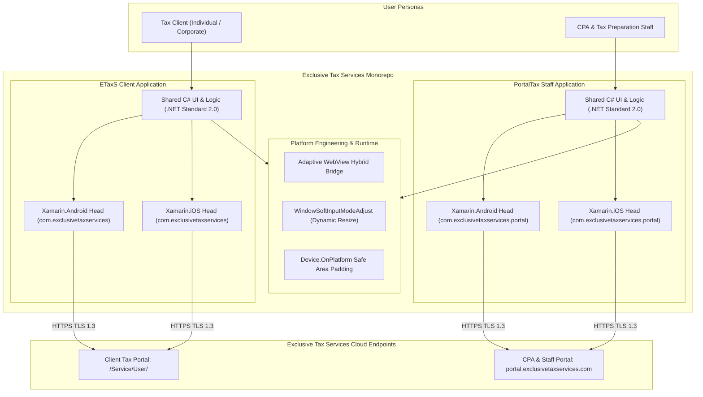

# Exclusive Tax Services - Enterprise Accounting & Tax Preparation Mobile Platform

[](https://docs.microsoft.com/en-us/dotnet/csharp/)
[](https://docs.microsoft.com/en-us/dotnet/standard/net-standard)
[](https://dotnet.microsoft.com/en-us/apps/xamarin)
[-3DDC84?style=for-the-badge&logo=android&logoColor=white)](https://developer.android.com/)
[](https://developer.apple.com/ios/)
[](https://visualstudio.microsoft.com/)
[](LICENSE)

An enterprise cross-platform mobile monorepo engineered for **Exclusive Tax Services**, a professional accounting, bookkeeping, and tax consulting firm. The monorepo consolidates both client-facing and internal staff operations into two specialized mobile applications developed with C# and Xamarin.Forms for Android and iOS:

1. **ETaxS (Client Services App):** Dedicated client application empowering individual and business clients to submit tax forms, upload W-2 and 1099 financial documentation, track IRS filing statuses, and view refund estimations.
2. **PortalTax (Staff / Accountant Portal App):** Internal operations application for Certified Public Accountants (CPAs), tax preparers, and accounting managers to review client tax filings, assign cases, audit financial statements, and track compliance milestones.

---

## Architectural Workflow



---

## Dual Application Suite

| Application | Project Scope | Target Audience | Core Functionality | Primary Endpoint |
| :--- | :--- | :--- | :--- | :--- |
| **ETaxS** | Client Tax Services App | Individual taxpayers, LLCs, small businesses | Tax document upload (W-2, 1099, receipts), refund tracking, filing status notifications, and direct messaging with tax consultants | `https://www.exclusivetaxservices.com/Service/User/` |
| **PortalTax** | Staff & CPA Management Portal | In-house CPAs, accounting managers, audit staff | Client portfolio management, tax preparation workflow oversight, document verification, and compliance status updates | `https://portal.exclusivetaxservices.com` |

---

## Key Technical Highlights

- **Unified Master Solution (`ExclusiveTaxServices.sln`):** Consolidates 6 projects (2 shared .NET Standard libraries, 2 Android heads, and 2 iOS heads) enabling simultaneous multi-target compilation in Visual Studio and JetBrains Rider.
- **Dynamic Soft Keyboard Adjustment:** Implements native Android platform configuration (`WindowSoftInputModeAdjust.Resize`) ensuring mobile keyboards do not obscure numeric input fields, deduction tables, or financial forms.
- **Safe Area & Display Notch Inset Handling:** Cross-platform padding calculation via `Device.OnPlatform` accommodating iPhone status bars, Dynamic Islands, and Android cutout displays.
- **Modern Packaging & Distribution:** Configured for Android App Bundle (`aab`) output with resource optimization, shrinking application download sizes for end-users.
- **Sanitized Security Policy:** Signing keystores, key passwords, and compiled binaries have been purged from version control. Production signing keys are designed for injection during automated CI/CD pipeline execution.

---

## Monorepo Project Structure

```text
xamarin-exclusive-tax-services/
├── ExclusiveTaxServices.sln      # Master solution linking all 6 client and staff projects
├── ETaxS.sln                     # Standalone solution for Client Tax App
├── PortalTax.sln                 # Standalone solution for Staff Portal App
├── ETaxS/                        # Client Services Mobile Application Suite
│   ├── ETaxS/                    # Shared Cross-Platform Project (.NET Standard 2.0)
│   │   ├── App.xaml / App.xaml.cs
│   │   ├── MainPage.xaml / MainPage.xaml.cs
│   │   ├── AssemblyInfo.cs
│   │   └── ETaxS.csproj
│   ├── ETaxS.Android/            # Android Head Project (API 29+, AAB support)
│   │   ├── Properties/AndroidManifest.xml
│   │   ├── MainActivity.cs
│   │   ├── Resources/ & Assets/
│   │   └── ETaxS.Android.csproj
│   └── ETaxS.iOS/                # iOS Head Project (iPhone / iPad)
│       ├── AppDelegate.cs
│       ├── Info.plist & Entitlements.plist
│       └── ETaxS.iOS.csproj
├── PortalTax/                    # Staff Management Mobile Application Suite
│   ├── PortalTax/                # Shared Cross-Platform Project (.NET Standard 2.0)
│   │   ├── App.xaml / App.xaml.cs
│   │   ├── MainPage.xaml / MainPage.xaml.cs
│   │   ├── AssemblyInfo.cs
│   │   └── PortalTax.csproj
│   ├── PortalTax.Android/        # Android Head Project (API 29+, AAB support)
│   │   ├── Properties/AndroidManifest.xml
│   │   ├── MainActivity.cs
│   │   ├── Resources/ & Assets/
│   │   └── PortalTax.Android.csproj
│   └── PortalTax.iOS/            # iOS Head Project (iPhone / iPad)
│       ├── AppDelegate.cs
│       ├── Info.plist & Entitlements.plist
│       └── PortalTax.iOS.csproj
└── .gitignore                    # Clean .NET/Xamarin exclusion rules
```

---

## Prerequisites & Development Setup

### System Requirements
- **Windows:** Visual Studio 2019 (v16.8+) or Visual Studio 2022 with the **Mobile development with .NET (Xamarin)** workload.
- **macOS:** Visual Studio for Mac or JetBrains Rider with Xcode 12+ and Android SDK Command-line Tools.

### Build & Compilation Steps

1. **Clone the Monorepo:**
   ```bash
   git clone git@github.com-personal:KevinAndrey96/xamarin-exclusive-tax-services.git
   cd xamarin-exclusive-tax-services
   ```

2. **Open in Visual Studio:**
   - Double-click `ExclusiveTaxServices.sln` to load both applications simultaneously.
   - Alternatively, open `ETaxS.sln` for client app development or `PortalTax.sln` for staff app development.

3. **Restore Dependencies:**
   Restore NuGet packages via Visual Studio Package Manager or command line:
   ```bash
   nuget restore ExclusiveTaxServices.sln
   ```

4. **Select Startup Project & Target Device:**
   - Set `ETaxS.Android` or `PortalTax.Android` as the Startup Project.
   - Select an Android Emulator or connected physical device.
   - Press **F5** (Debug) or **Ctrl+F5** (Run without debugging).

---

## Release Signing & Deployment Best Practices

For production distribution on the Google Play Store and Apple App Store:

- **Android (Keystore Signing):** Configure CI/CD environment variables (`ANDROID_KEYSTORE_BASE64`, `ANDROID_KEYSTORE_PASSWORD`, `ANDROID_KEY_ALIAS`) to sign `.aab` bundles during release pipelines without committing credentials to source control.
- **iOS (Provisioning Profiles):** Bind development and distribution provisioning profiles through Apple Developer Certificates in Fastlane or GitHub Actions runners.

---

## Author & Engineering Credits

- **Mobile Architecture & Engineering:** [Kevin Andrey Herrera Silva](https://github.com/KevinAndrey96)
- **Primary Contact:** [kahs_kevin@hotmail.com](mailto:kahs_kevin@hotmail.com)
- **Portfolio Showcase:** [KevinAndrey96](https://github.com/KevinAndrey96)

---

## License

This monorepo is licensed under the [MIT License](LICENSE).
